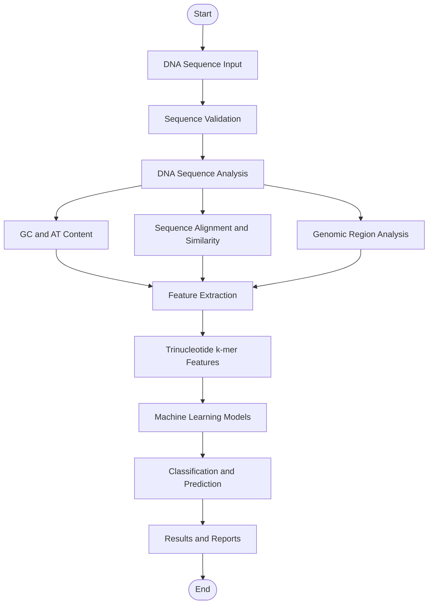

# 🧬 DNAura
### DNA Sequence Classification & Prediction System

<p align="center">
  <strong>YOUR DNA. YOUR INSIGHT.</strong>
  <br/>
  Transforming genomic sequences into meaningful insights through bioinformatics and machine learning.
</p>

<p align="center">
  
  
  
  
</p>

<p align="center">
  <a href="https://github.com/sanjanavernekar03/AI-Powered-DNA-Sequence-Classification-and-Prediction-System">
    
  </a>
</p>

---

## 📌 Table of Contents

- [About DNAura](#-about-dnaura)
- [Key Features](#-key-features)
- [Genomic Classification](#-genomic-classification)
- [System Workflow](#-system-workflow)
- [Technology Stack](#-technology-stack)
- [Project Structure](#-project-structure)
- [Installation](#-installation-and-setup)
- [Running the Application](#-running-the-application)
- [Administrator Dashboard](#-administrator-dashboard)
- [Future Enhancements](#-future-enhancements)
- [Disclaimer](#-disclaimer)
- [Author](#-author)

---

## 🧬 About DNAura

**DNAura** is a bioinformatics and healthcare-oriented web application designed for DNA sequence analysis, genomic classification and disease-risk prediction.

The system processes DNA sequences containing four nucleotide bases:

| Base | Name |
|:---:|---|
| A | Adenine |
| T | Thymine |
| G | Guanine |
| C | Cytosine |

By combining bioinformatics techniques, genomic feature extraction and machine-learning models, DNAura analyses DNA sequences and presents classification and prediction results through an integrated web interface.

The platform also incorporates healthcare support, report generation, multilingual interaction and administrative management.

## ✨ Key Features

<table>
<tr>
<td width="50%">

### 🔬 DNA Sequence Analysis

- DNA sequence input and processing
- GC and AT content calculation
- Sequence similarity analysis
- Sequence alignment
- Mutation-related analysis
- Identification of CDS, promoters and introns

</td>
<td width="50%">

### 🤖 Genomic Classification

- Trinucleotide k-mer feature extraction
- 64-dimensional feature representation
- Random Forest classification
- Gradient Boosting prediction
- Genomic risk classification

</td>
</tr>
<tr>
<td width="50%">

### 📊 Reports & Visualization

- Analysis result presentation
- Classification and prediction records
- Report generation
- Data visualization

</td>
<td width="50%">

### 🏥 Healthcare Support

- Hospital-related information
- Healthcare-oriented assistance
- Genomic result monitoring
- High-risk case monitoring

</td>
</tr>
<tr>
<td width="50%">

### 💬 Interactive Experience

- Multilingual interaction
- Chatbot-based assistance
- Website feature navigation

</td>
<td width="50%">

### ⚙️ Administration

- Dedicated administrator access
- Dashboard analytics
- User management
- Upload and prediction monitoring
- Audit logs and reports

</td>
</tr>
</table>

## 🧪 Genomic Classification

DNAura supports the following classification categories:

| Category | Classification |
|---|---|
| 01 | Cancer |
| 02 | Cystic Fibrosis |
| 03 | Healthy |
| 04 | Huntington's Disease |
| 05 | Sickle Cell Disease |

### Machine-Learning Models

**Random Forest**
- Uses genomic features extracted through trinucleotide k-mer analysis.
- Uses a 64-dimensional feature representation.

**Gradient Boosting**
- Supports genomic risk prediction through the project's trained model.

**Model identifiers:**
- `RandomForestClassifier_kmer`
- `GenomicRiskGradientBoosting`

## 🔄 System Workflow



## 🛠️ Technology Stack

| Layer | Technologies |
|---|---|
| Programming Language | Python 3.12.10 |
| Backend | Flask |
| Database | MySQL |
| Database Connector | MySQL Connector/Python |
| Machine Learning | Scikit-learn |
| Data Processing | Pandas, NumPy |
| Scientific Computing | SciPy |
| Bioinformatics | Biopython |
| Model Management | Joblib |
| Report Generation | ReportLab |
| Visualization | Matplotlib |
| Environment Configuration | Python-dotenv |
| Testing | Pytest |
| Version Control | Git, GitHub |

## 📁 Project Structure

```text
DNA_PROJECT/
│
├── dataset/
│   └── hospital_knowledge/
│
├── templates/
│
├── static/
│
├── reports/
│
├── schema.sql
├── requirements.txt
├── run.py
├── .env.example
├── .gitignore
└── README.md
```

*The directory tree above highlights selected project components; additional modules and files are included in the repository.*

## 💻 Installation and Setup

### Prerequisites

- Python 3.12.10
- MySQL Server
- Git
- pip

### 1. Clone the Repository

```bash
git clone https://github.com/sanjanavernekar03/AI-Powered-DNA-Sequence-Classification-and-Prediction-System.git
```

### 2. Open the Project Directory

```bash
cd AI-Powered-DNA-Sequence-Classification-and-Prediction-System
```

### 3. Create a Virtual Environment

```bash
python -m venv .venv
```

### 4. Activate the Environment

**Windows PowerShell**

```powershell
.\.venv\Scripts\Activate.ps1
```

### 5. Install Dependencies

```bash
python -m pip install --upgrade pip
pip install -r requirements.txt
```

### 6. Configure the Database

Ensure that MySQL Server is running.

Create your local `.env` file using `.env.example` as a reference and configure:

```env
DB_HOST=localhost
DB_PORT=3306
DB_NAME=ai_dna_merged_project
DB_USER=your_mysql_username
DB_PASSWORD=your_mysql_password
```

Replace the example values with your own MySQL credentials.

The application creates the configured database and initializes the schema using `schema.sql` during startup.

## 🚀 Running the Application

Start the application:

```bash
python run.py
```

Open the following URLs in your browser:

| Application | URL |
|---|---|
| Main Application | http://127.0.0.1:5000/ |
| Administrator Panel | http://127.0.0.1:5000/admin |

## ⚙️ Administrator Dashboard

The administrator dashboard provides centralized application management.

**Available capabilities include:**

- Dashboard statistics and analytics
- User search and management
- Account activation and deactivation
- Role management
- DNA upload monitoring
- Classification and prediction monitoring
- High-risk case monitoring
- Report management
- Audit logs
- Dark, Light and System themes

Administrator access requires valid application credentials. Never publish real passwords or default administrator credentials in the repository.

## 🌐 Multilingual Interaction

DNAura supports interaction in:

- English
- Kannada
- Hindi
- Tamil
- Telugu

### Interactive Modules

| Module | Purpose |
|---|---|
| DO IT | Website actions and feature navigation |
| TALK TO ME | Chatbot-based interaction |

## 🔮 Future Enhancements

- Telehealth integration
- Home sample collection services
- Further improvements to genomic analysis
- Expanded healthcare support features

## ⚠️ Disclaimer

DNAura is an academic bioinformatics and software development project. Its classification and prediction outputs are intended for educational and research purposes and should not be treated as a clinical diagnosis or a substitute for professional medical advice or genetic counselling.

## 👩‍💻 Author

<p align="center">
  <strong>Sanjana Vernekar</strong>
  <br/>
  Computer Science and Engineering
  <br/><br/>
  <a href="https://github.com/sanjanavernekar03">
    
  </a>
</p>

---

<p align="center">
  <strong>🧬 DNAura — YOUR DNA. YOUR INSIGHT.</strong>
  <br/>
  <em>Exploring Genomic Insights Through Technology.</em>
</p>